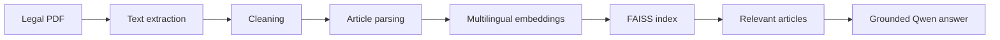

<div align="center">

# MoroccoLaw-LLM

### A learning-focused RAG prototype for Moroccan legal documents


[](https://github.com/deleted04user/MoroccoLaw-LLM/actions/workflows/notebook-quality.yml)

An educational notebook that transforms a Moroccan legal PDF into searchable articles and uses retrieval-augmented generation to produce answers grounded in the retrieved source text.

[Open in Google Colab](https://colab.research.google.com/github/deleted04user/MoroccoLaw-LLM/blob/main/notebooks/Lesson_01_Setup.ipynb)

</div>

---

**Explore:** [Pipeline](#pipeline) · [Setup](#getting-started) · [Scope](#current-scope) · [Verification](#verification)

## Overview

MoroccoLaw-LLM demonstrates the foundations of a legal RAG workflow using the Moroccan *Code des Obligations et des Contrats* as an example source. The project extracts PDF text, detects individual articles, creates multilingual embeddings, searches them with FAISS, and asks a compact Qwen instruction model to answer only from retrieved context.

This repository is a learning prototype. It is not a complete legal product and does not provide legal advice.

## Pipeline



## What the Notebook Covers

- Google Colab and local Jupyter setup
- Configurable project directories
- Qwen2.5-0.5B-Instruct loading and inference
- PDF text extraction with PyMuPDF
- Legal-text normalization
- Article detection with regular expressions
- Structured JSON generation
- Multilingual Sentence Transformer embeddings
- Cosine-similarity search with FAISS
- Source-grounded prompting and article citations
- Optional instruction-dataset generation
- JSON repair and dataset validation

## Technology Stack

| Area | Technology |
| --- | --- |
| Language | Python |
| Notebook | Jupyter / Google Colab |
| Language model | Qwen2.5-0.5B-Instruct |
| Embeddings | paraphrase-multilingual-MiniLM-L12-v2 |
| Vector search | FAISS |
| PDF processing | PyMuPDF |
| ML tooling | Transformers, Datasets, PEFT, TRL, Accelerate |

## Repository Structure

```text
MoroccoLaw-LLM/
├── notebooks/
│   └── Lesson_01_Setup.ipynb
├── scripts/
│   └── validate_notebook.py
├── .github/workflows/notebook-quality.yml
├── .gitignore
├── LICENSE
├── requirements.txt
└── README.md
```

The notebook creates the following local directories while running. They are ignored by Git because they can contain source documents, generated datasets, or large model artifacts.

```text
datasets/
├── raw/legal_documents/
├── cleaned/
├── processed/
└── training/
models/
checkpoints/
outputs/
```

## Getting Started

### Google Colab

1. Open the notebook using the Colab button above.
2. Run the dependency-installation cell.
3. Restart the runtime if Colab requests it.
4. Place an authorized copy of `Code_obligations_contrats.pdf` in:

   ```text
   /content/drive/MyDrive/MoroccoLaw-LLM/datasets/raw/legal_documents/
   ```

5. Run the remaining cells in order.

### Local Jupyter

```bash
git clone https://github.com/deleted04user/MoroccoLaw-LLM.git
cd MoroccoLaw-LLM
python -m venv .venv
source .venv/bin/activate
pip install -r requirements.txt
jupyter notebook notebooks/Lesson_01_Setup.ipynb
```

On Windows PowerShell, activate the environment with:

```powershell
.\.venv\Scripts\Activate.ps1
```

## Example Question

```text
Quelles sont les conditions de validité d'un contrat ?
```

The system retrieves the most relevant legal articles, passes them to Qwen as constrained context, and returns the answer together with the source articles used.

## Current Scope

This first lesson is an end-to-end prototype rather than a production system. It currently uses one example legal code, regex-based structure detection, dense retrieval, and a lightweight local model.

## Roadmap

- [ ] Add document name, page number, chapter, and section metadata
- [ ] Support additional official Moroccan legal sources
- [ ] Add Arabic/French bilingual normalization and retrieval
- [ ] Combine BM25 and dense retrieval
- [ ] Add deterministic citation and numerical-claim verification
- [ ] Create a reviewed legal evaluation dataset
- [ ] Add automated tests and reproducible benchmarks
- [ ] Expose the pipeline through a FastAPI service
- [ ] Build a bilingual web interface

## Responsible Use

- Use official or otherwise authorized legal documents.
- Keep provenance metadata for every extracted article.
- Review generated instruction examples before training.
- Verify every answer against the cited source text.
- Do not treat model output as professional legal advice.

## Verification

Run the repository's lightweight notebook structure and secret-safety check:

```bash
python scripts/validate_notebook.py
```

## Disclaimer

MoroccoLaw-LLM is an educational and research project. Its output may be incomplete or incorrect and must not replace consultation with a qualified legal professional.

## License

Original project code is released under the [MIT License](LICENSE). Source legal documents, model weights, and third-party datasets retain their respective rights and licenses.

---

[Oussama Oulkaid · GitHub profile](https://github.com/deleted04user) · [Explore the project portfolio](https://github.com/deleted04user/deleted04user/blob/main/PORTFOLIO.md)
